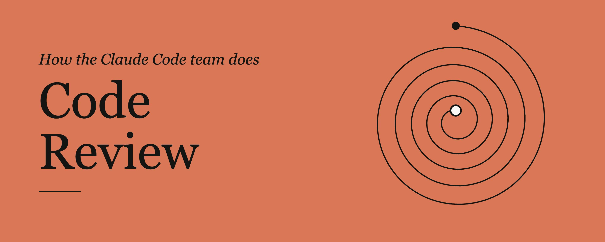
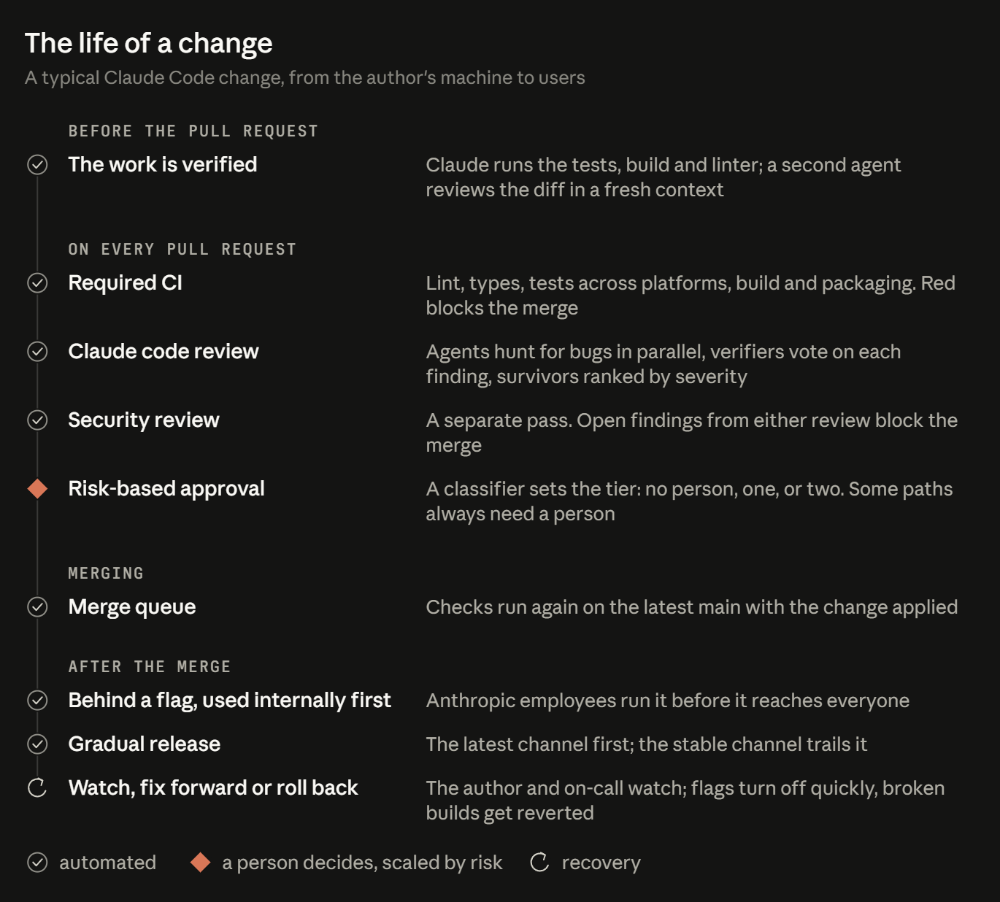
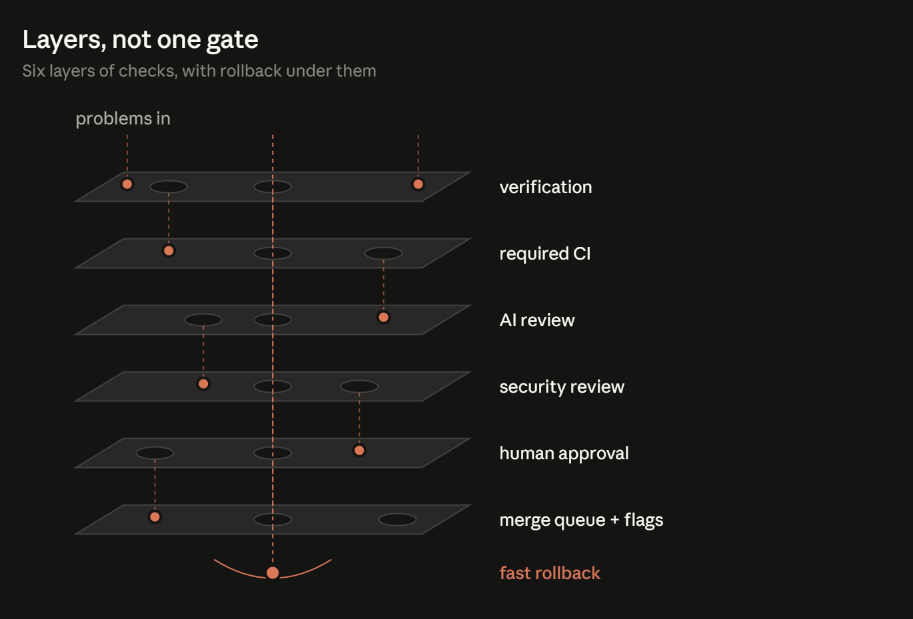
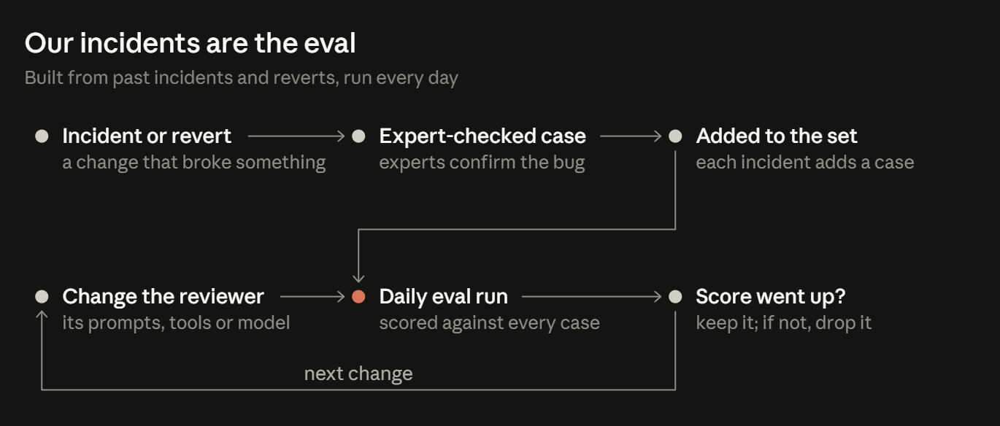
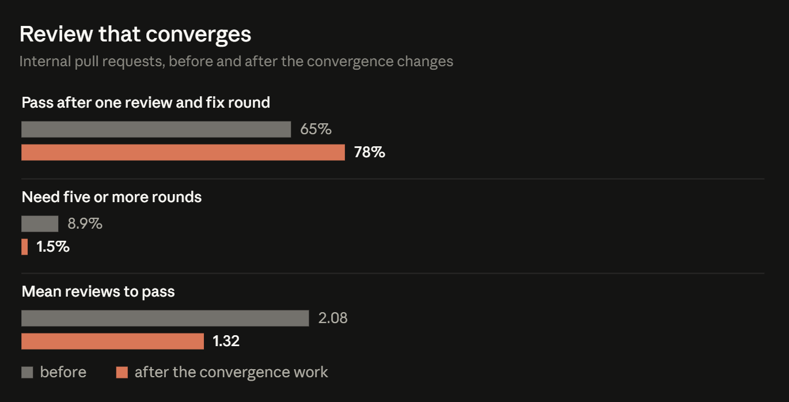
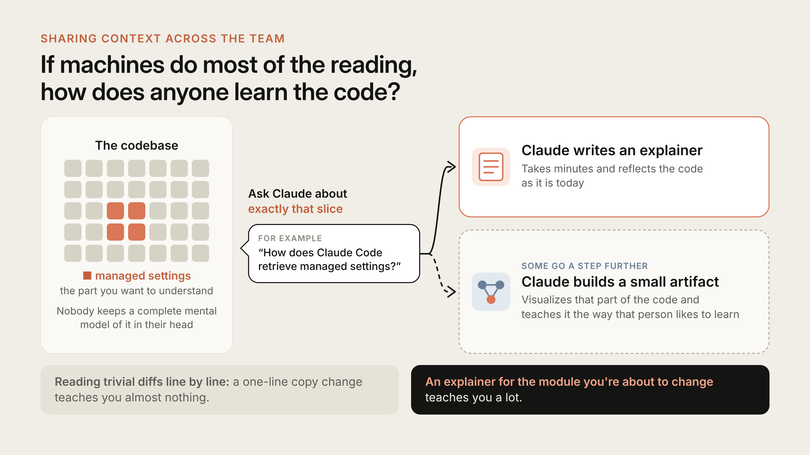

# Claude Code 团队如何进行代码审查

面对智能体产出的海量代码，你该如何审查？在 Claude Code 团队，当我们实现了高覆盖率和深度审查之后，便开始优化，目标是用最少的人工审查时间，同时不增加回滚率或事故率。

- 作者：Addy Osmani、Morgan Westlee Lunt、Qing Wang（技术员工）
- 发布日期：2026-10-15
- URL：<https://claude.dev/blog/solving-code-review-at-anthropic/>

>
> 本文为上述原文的中文翻译/整理。
> 本译文为非官方译本，与 Anthropic 无关联。仅供个人学习、研究与查阅使用。
>
---

我们之前说过，Claude 编写了 [Claude Code](https://claude.com/product/claude-code) 自身约 90% 的代码。那么，我们如何审查如此体量产出的代码？还有人读代码吗？如果出了问题，谁来发现？

本文介绍 Claude Code 团队的代码审查流程及其演进过程。从六月到九月，Claude Code 代码库合并的拉取请求数量翻了一倍多，而需要回滚的比例下降了 40% 以上。

我们并没有取消审查。但我们把大部分阅读工作交给了机器，优化了人类的时间与注意力分配，并大力投入让撤销错误变得快速而简单。

## 重新思考代码审查的目的

当智能体编写代码时，变更数量会快速增长。在 Anthropic 的 monorepo 中，每天落地的变更从五月的约 [2,500 个增长到九月的 30,000 多个](https://www.anthropic.com/engineering/redesigning-source-control)。

Claude Code 位于独立的代码库中，与 monorepo 分开，但也面临着巨大的压力。当以这样的速度交付时，逐行的人工代码审查即使并非不可能，也极其困难。

代码审查有两个职责：

1. 在代码上线前发现并修复问题
2. 在团队中建立共享上下文和对代码库的理解

本文主要关注发现和修复问题，但我们会在结尾回到第二个职责。

我们认为“有没有人读过代码？”并不能准确反映“这个变更可能出什么问题，哪种检查——自动的还是人工的——最适合发现它？”

提出这个问题也改变了审查发生的*时机*。以前，审查是终点线上的一道关卡：写代码、开 PR、等同事来看。

现在，审查持续进行，更像是写作时的拼写检查。大多数变更在请求人工查看之前，已经至少被 Claude 审查并修复过一次。这能捕获大多数常规错误，把团队的注意力留给更高层次的问题和审查。

## 稀缺资源：人类的时间与注意力

我们希望把人类的时间和注意力保留给只有人类才能解决的问题，确保自动化检查捕获其余的问题。以我们当前的变更速度，人类仍有大量工作要做，团队几乎每天都会遇到新的、 novel 的挑战。

人类时间涵盖审查成本的两个方面：人们花在审查上的时间，以及花在修复坏代码造成的问题上的时间。削减前者如果只是让时间转移到后者，那就没有帮助。

因此，目标是 Claude Code 各代码库（CLI、桌面端和 Web 应用、移动应用）中的大多数拉取请求在最多一个人（可以是作者本人）参与的情况下合并，且不增加回滚率或事故率。为了衡量人类时间，我们跟踪每个 PR 的人工批准数（中位数和第 95 百分位数）、人工评论数，以及 PR 等待某个人所花的时间。回滚率和事故率是护栏指标：如果它们上升了，我们就没有节省人类时间，只是把时间转移了。

## 一个变更的生命周期

一个典型的变更，从工程师的笔记本电脑（或 Slack 中的 Claude 会话）出发，经过多层代码审查。

*大部分路径是自动化的；人的注意力花在风险所在的地方*

## 逐层解析

*每一层都能捕获一些问题，也会遗漏另一些。很少有问题能穿过所有层，回滚处理剩下的。*

### 1. 在任何人查看之前，工作已经过验证

现在大多数审查发生在 PR 存在之前。我们给 Claude 一些它可以运行的东西——比如测试、构建或与设计对比的截图——并要求它展示输出，而不是说“完成了”。然后一个子智能体用全新的上下文审查 diff。这两个习惯都来自我们的[最佳实践指南](https://code.claude.com/docs/en/best-practices)。

在开 PR 之前，我们中的许多人还会运行几个[内部技能](https://claude.dev/blog/lessons-from-building-claude-code-how-we-use-skills/)：一个查找 bug，一个简化 diff，一个端到端检查行为。UI 变更还会对照我们的设计指南进行检查。

Claude Code 的创造者 Boris Cherny 曾说过，给 Claude 一种验证其工作的方式[可能是最重要的事情](https://x.com/bcherny/status/2007179861115511237)，能获得好的结果。他估计这能让最终结果好两到三倍，并写道：“验证在每个领域看起来都不同。它可能简单到运行一个 bash 命令，或运行一个测试套件，或在浏览器或手机模拟器中测试应用。”

**当自动审查器反复标记同一问题时，我们从源头修复：**在技能中、通过 lint 规则，或更新指导文件，例如：

- `CLAUDE.md` 告诉 Claude 项目是什么：技术栈、约定、目标和非目标。每次审查都会加载它，所以在大型代码库中我们保持简短，并从那里指向其他文档。审查器还会标记违反其中约定的代码，以及使其中某行过时的变更。
- `REVIEW.md`，由代码所有者编写，告诉审查器他们那部分代码中什么重要。我们会单独检查审查器是否真的遵循了它。好的 `REVIEW.md` 很简短。它们说明该仓库中失败是什么样的（对于文档来说是“它说谎”，对于配置来说是“它错误路由”），限制小问题的数量，列出要跳过的路径，并要求提供文件和行号作为证据，而不是根据名称猜测。它们还要求摘要以计数开头，并在没有需要修复的问题时直接说明。

### 2. 每个拉取请求上的 AI 审查

每个拉取请求在人工查看之前都会得到 Claude 的审查。它对照整个仓库和 PR 声明的意图来阅读 diff，并问：这个变更解决了它的问题吗？适合系统吗？会破坏其他东西吗？

在 bug 修复上，它寻找根本原因。公开版本 [Code Review for Claude Code](https://code.claude.com/docs/en/code-review) 现已在 Team 和 Enterprise 计划上全面可用，`/code-review` 在本地运行一个更轻量的版本。

当我们[推出研究预览版](https://claude.com/resources/articles/code-review)时，获得实质性审查评论的内部 PR 比例从 16% 上升到了 54%。大多数超过 1,000 行的 PR 会得到发现，大多数小 PR 则干净通过。管理员将每个仓库设置为 Quick、Standard 或 Deep。在漏掉一个 bug 的代价高于额外审查时间的地方，Deep 是值得的。

**发现的问题在人类审查之前会由其他智能体验证。** 多个智能体同时查找 bug。然后一个单独的组对每个发现进行投票，只有足够多的智能体同意它是真实的，才会被发布。仅涉及风格、诊断或清理的发现会被丢弃。我们在保留这些过滤器之前，在自己的 PR 上进行了 A/B 测试。剩下的内容以按严重程度排序的行内评论形式出现。每个都被标记为 Important、Nit 或 Pre-existing，这样 PR 没有引入的 bug 就不会看起来像是作者的错。

**每个发现都必须得到回应。** 你要么修复它，要么用理由解决该线程。通常一个智能体会在一夜之间接手修复，所以作者回来时会看到一个已经经过另一轮审查的 PR。

### 3. 可以阻止合并的安全审查

安全也有自己的自动审查。当 bug 审查或安全审查的任何发现仍未解决时，PR 不能合并。你要么修复它，要么用简短的理由关闭线程，这就是清除误报的方式。

如果后续提交修复了该问题，发现会自动清除。你可以用开源安全审查 GitHub Action 或 `/security-review` 命令设置同样的功能。设置方法在 [Claude Code 中的自动安全审查](https://support.claude.com/en/articles/11932705-automated-security-reviews-in-claude-code)中有介绍。

### 4. 可以阻止合并的自动化检查

常规的：lint、类型检查、每个平台上的测试，以及构建。（我们在这里写过如何为这种量级扩展 CI：[链接](https://claude.com/resources/articles/agentic-coding-is-straining-ci-heres-how-we-scaled-test-impact-analysis-at-anthropic)。）一个典型的 CLI 拉取请求在任何人查看之前可能会运行几十项检查。PR 模板询问变更是如何测试的以及如何撤销。Claude 可以填写，但请求变更的人要签字确认。

### 5. 按风险分级的人工批准

文档修复和自动更新器变更承载不同的风险，因此它们得到不同的审查。

| 风险 | 示例 | 人工批准 |
| ------ | ------------------------------------------------------------------------------------------------------------- | ----------------------------------------------------------------- |
| 低 | 文档、文案、仅内部功能、功能标志后的增量变更 | 自动审查和安全检查通过后无需人工批准 |
| 中 | 普通产品变更，以及对缓存、自动更新器或系统提示等敏感区域的变更 | 一人 |
| 高 | 最高风险的代码，以及一小部分始终需要两人的路径 | 两人 |

**由变更决定层级，而不是作者。** 一个分类器读取变更并选择其风险层级。第二个分类器询问这个特定变更是否需要另一个人，即使其层级说不需要。某些路径始终需要一个人，所有者列为敏感的任何内容以及任何 CI 工作流文件。

**只有受信任的作者才能走更轻的路径。** 只有仓库受信任列表上的作者才能走更轻的路径，主要是拥有该仓库的团队。其他所有人都需要第二个人批准。智能体的批准也永远不算作人的批准。自动审查可以清除低风险变更，但它不能填补需要人类的空缺。

**发起变更的人要对其负责。** 在智能体编写的 PR 上，指导智能体的人算作所需审查者之一，就像他们自己输入了代码一样。

**一个批准只覆盖一个特定的提交。** 如果新的提交落地，而系统无法为其担保（比如智能体的推送或有人手动解决的合并），批准必须重新给出。

### 6. 合并队列、功能标志和逐步发布

合并队列会在应用变更的情况下对 main 重新运行所有检查，这样两个单独通过的 PR 不会组合成一个坏掉的 main。新行为通常先通过功能标志发布给 Anthropic 员工，我们的重度使用往往会在用户之前发现回归。公开发布先进入 `latest` 渠道。`stable` 渠道跟随其后。

### 7. 快速检测，快速回滚

有些错误仍然会漏过去，所以最后一层是关于快速捕获它们。功能标志无需部署即可关闭。Claude Code 有每周值班轮换，事故回顾会问哪一层本应捕获该问题。

注意到坏合并仍然依赖于作者和值班人员以及回滚和事故仪表盘。我们还没有在那些数字变动时收紧批准的断路器；这里的工程师希望在更多代码转向零人工合并之前拥有它们。

一位同事说，放慢速度确实会降低错误率，但主要是因为你在做的所有事情都变少了。我们宁愿变得更擅长发现和修复问题。

## 我们如何让审查器变得更好

我们的代码审查流程在一个循环中不断改进。

**任何事故现在都是一个评估。** 团队收集了过去导致事故的 PR，以及它们的向前修复和回滚，并让了解该代码的工程师确认每个 bug 及其所在位置。审查器每天针对该集合运行。

*评估集随每次事故增长，对审查器的每次变更都会针对全部评估集评分。*

**我们通过观察人们如何处理评论来衡量噪音。** 如果你不介意标记大量非 bug，就很容易捕获更多 bug，所以我们需要对此进行检查。我们按 PR 上的人如何回应来对审查器留下的每条评论进行分类：他们修复了它、说它是错的、说行为是有意的，或决定它不重要。我们还在已知干净的 PR 上运行审查器，并计算它报告了多少会导致某人做出有害变更的内容。我们写下的优先级是：首先捕获真正的 bug，其次减少审查轮次。

当作者是智能体时，噪音的代价更高。一个人可以在几秒钟内挥开一个小问题。智能体会修复它，这意味着另一个提交和另一轮审查。

**审查必须收敛。** 智能体作者和智能体审查器可以让彼此无限忙碌。一个 CLI PR 在一夜之间经历了五十多轮审查和修复，直到其作者叫停。

当我们对审查器反复标记的内容运行 git blame 时，大约 59% 是自审查器第一轮以来就存在的代码。审查器很少发现新 bug，它每轮都在发现一些更旧的 bug。

我们自己让它变得更糟了。我们习惯了默认运行几轮，因为每一轮都会捕获一些新东西。这在有风险的变更上可能值得，但不是每个 PR 都值得。团队现在跟踪通过轮次和召回率，并改变了重新审查的方式：

- **轮次上限。** 三轮之后，审查器要求作者退一步重新考虑方法。
- **前几轮之后仅审查 diff。**
- **标记 bug 类别，** 这样作者修复每个实例，而不是一行。
- **不重复**已发布的发现。

审查智能体还会每晚对现有代码运行，帮助我们在旧 bug 在其他地方出现之前捕获它们。

*收敛变更后每个内部拉取请求的审查轮次减少*

## 人类在哪些环节保持参与

把一位资深工程师从深度工作中拉出来去捕获一个常规错误，代价远高于一次自动审查。团队成员仍然负责：

- **决定是否要构建它。** 方向、品味和范围。一个宣布其审查瓶颈已解决的团队仍然保留了对来自团队外部的变更的人工审查，这样有人会问“我们到底该不该做这个？”
- **审查有风险的代码**，如计费、自动更新器和 CI 工作流。
- **审查架构**，即设定他人会复制的模式的架构。
- **阅读证据。** 测试输出、运行的命令及其返回内容、截图、审查器的发现。如果你说不出检查会遗漏什么，就要求真正的审查，而不是快速批准。
- **对结果负责。** 一个人对每一个上线的变更负责，无论谁输入的。

## 在团队中共享上下文

代码审查的第二个职责一直是传播代码库理解。阅读队友的 diff 是你了解发生了什么变化以及各部分如何组合的方式。如果机器完成了大部分阅读，人们如何学习代码？

我们没有正式的流程。团队中没有人脑中保留着 Claude Code 的完整心智模型，我们认为没有人需要这样做。当有人想了解代码库的某一部分时，他们让 Claude 为那个确切的切片写一份解释。这只需几分钟，并且反映的是今天的代码。

我们中的一些人更进一步，让 Claude [构建一个小工件](https://claude.dev/blog/using-claude-code-the-unreasonable-effectiveness-of-html/)来可视化代码的那部分，并以那个人喜欢的学习方式教学。

如果目标是把人类注意力花好，这比逐行阅读琐碎的 diff 要好。一行文案变更几乎教不了你什么。为你即将更改的模块写一份解释则教给你很多。我们默认在开放的 Slack 频道上工作的文化也有帮助，因为你在别人构建时就能看到他们在做什么。

## “你落地的，你负责”

如果你落地了一个小型或中型变更，而仍然出了问题，团队规范是你通常要修复它。有几件事可以防止这种情况变糟：

- **变更很小，** 所以容易审查、调试和回滚。
- **一切都是可逆的。** 功能标志、回滚和分阶段发布可以在几分钟内撤销大多数错误。
- **爆炸半径决定标准。** 昂贵的代码需要更多人和更多检查。
- **回归会快速浮出水面**，通过遥测和内部使用。
- **这不是追责。** 拥有修复意味着你拥有最多的上下文；事故回顾看的是系统。

所有权也是共享的。团队大部分人在[开放频道](https://claude.com/product/tag)工作，任何人都可以看到别人在构建什么、接手一个线程，或让 Claude 去填补一个空白，反馈也来自不拥有该代码的人。这种开放性是在没有逐行关卡的情况下保持高质量的重要原因。

## 当我们改变方向时

智能体让启动事情变得廉价，所以有些工作不应该落地。通常频道里有人问为什么，指向早先的决定，或建议更简单的路线，然后作者关闭或重塑 PR。

由于代码写起来很快，关闭 PR 不会感觉像损失。诀窍是在线程中尽早提出不同的方向，而不是作为已完成 PR 上的阻塞性评论。

## 你如何采用这个流程

与你的团队一起做这件事的大部分组件今天已经存在。

### 在拉取请求之前

- 给你的智能体它可以运行的检查，列在一个简短的 `CLAUDE.md` 中，加上运行格式化器和 linter 的钩子。
- 在本地运行 `/code-review` 和 `/security-review`，或一个全新上下文的子智能体审查。
- 添加一个 `REVIEW.md`，把重复的审查评论移到其中。

### 在每个拉取请求上

- 要求 CI，并在 PR 模板中添加“测试”、“风险”和“如何回滚”。
- 在一个仓库上添加 AI 审查器（Code Review for Claude Code，或 Claude Code GitHub Action），花几周调整 `REVIEW.md`，然后扩大范围。
- 添加自动安全审查，并要求合并前解决每个审查线程。
- 让审查力度与风险匹配：对常规变更快速过一遍，在漏掉 bug 代价高昂的地方深入审查（Code Review 中的 Quick、Standard 或 Deep）。
- 限制审查轮次；前几轮之后，只重新审查新的 diff。

### 批准

- 写下风险层级，由变更而非作者设定；从严格开始，根据证据放宽。
- 为你信任的作者保留更轻的批准路径。
- 使用 CODEOWNERS 和分支保护，使认证、计费、CI 和发布工作流以及安装程序始终需要一个人。
- 永远不要让机器人的批准替代所需的人类批准；在新提交上撤销批准。

### 合并及之后

- 使用合并队列、功能标志、先内部使用、分阶段发布和一步回滚。
- 将事故和回滚转化为评估集，每当审查器的提示、工具或模型变更时重新评分。
- 衡量人类时间，以回滚率和事故率作为护栏。

## 这将走向何方

Code Review 的[公告](https://claude.com/resources/articles/code-review)说，批准拉取请求仍然是人类的决定；产品发布发现，而不是批准。我们自己的仓库走得更远，让所有者决定哪些低风险变更仅凭自动化检查即可合并，而且这条线还在移动。

当审查遗漏了什么时，我们问模型面前缺少什么，并把修复放入 `CLAUDE.md`、技能或新的检查中。目标没有改变：每个变更的人类时间更少，回滚不比以前多。

如果你的团队让智能体开拉取请求，我们想听听你自动化了哪些检查，哪些仍然需要人，以及你认为我们哪里做错了。

*感谢 Emma Webb、Michael Segner 和 Amie Rotherham 的审阅。*